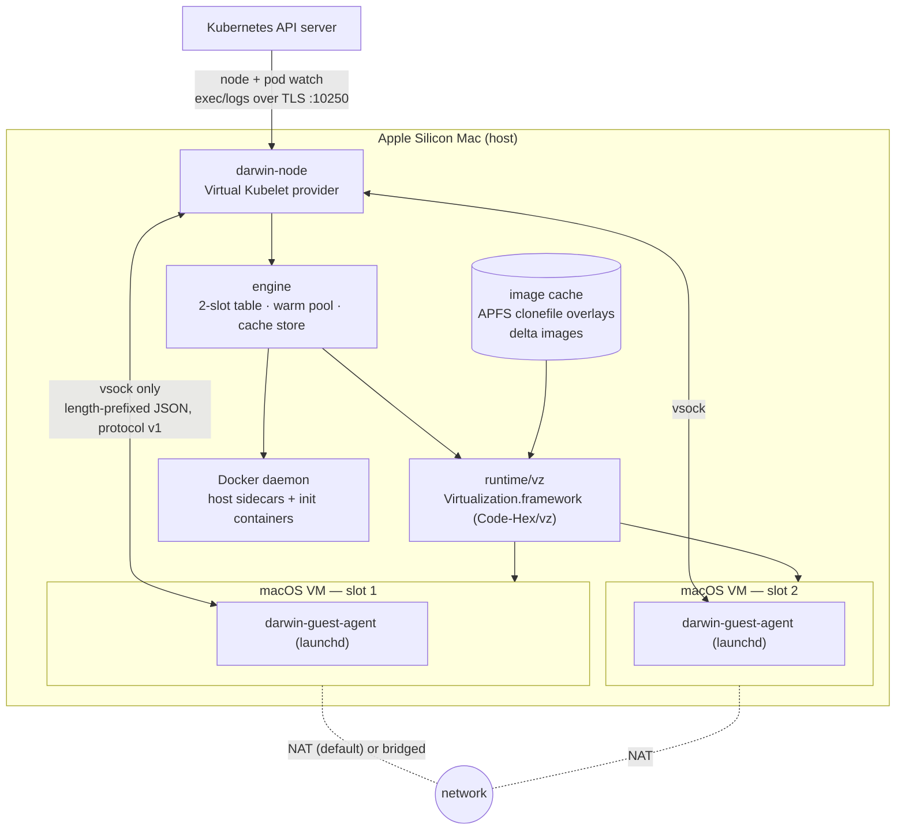

# darwin-node

[](https://github.com/mlvea/darwin-node/actions/workflows/ci.yml)
[](LICENSE)


**Run macOS as Kubernetes pods on Apple Silicon.** `darwin-node` is a
[Virtual Kubelet](https://virtual-kubelet.io) node agent for M-series Macs.
It joins your cluster as a node. Each pod's first container is a macOS VM
booted with Apple's
[Virtualization.framework](https://developer.apple.com/documentation/virtualization)
(through [Code-Hex/vz](https://github.com/Code-Hex/vz)). Any other containers
run as Docker sidecars on the host. A Mac runs **at most two** of these VMs at
a time. The main use is macOS CI (Xcode builds, simulators, signing) scheduled
like any other workload.

---

> [!WARNING]
> **Alpha: control plane verified, hardware pending.**
> Most of this code was written with coding agents and is still under review.
> Linux and macOS CI cover the engine, guest protocol, images and kubelet auth,
> using a fake runtime. **No real VM has been booted under the release gate
> yet.** The hardware gate (`make test-hardware`) and the 24-hour
> Virtualization.framework soak have not been run on a real Mac. Do not use
> darwin-node as the kubelet for a production Mac fleet. Flags, APIs and the
> guest protocol may still change. Provided **AS IS**, without warranty (see
> [License](#license)).

| Area | Status | How it's checked |
|---|---|---|
| Pod lifecycle, 2-slot admission, warm pool, cache volumes, drain | ✅ Verified (fake runtime) | `go test ./... -short -race` on Linux and macOS CI |
| Guest-agent protocol (framing, limits, capability handshake) | ✅ Verified | Unit and adversarial tests in `pkg/guest` |
| Kubelet authn/authz (client CA, TokenReview, SubjectAccessReview) | ✅ Verified against a real API server | `make test-kubelet-auth` (envtest, kube-apiserver + etcd 1.35) |
| Real VM boot, exec, logs, metrics, delete | ⏳ Hardware pending | `make test-hardware IMAGE=...` on a Mac, not run yet |
| 24 h adopt/delete soak on Virtualization.framework | ⏳ Hardware pending | `make soak IMAGE=...`, not run yet |
| Bridged/routed pod networking | ⏳ Design chosen, not built | See [Roadmap](#roadmap) |

---

## Contents

- [How it works](#how-it-works)
- [Requirements](#requirements)
- [Quick start](#quick-start)
- [Scheduling a macOS pod](#scheduling-a-macos-pod)
- [Configuration](#configuration)
- [Build and test](#build-and-test)
- [CI](#ci)
- [Security model](#security-model)
- [Limitations](#limitations)
- [Hardware validation](#hardware-validation)
- [Roadmap](#roadmap)
- [Repository layout](#repository-layout)
- [Documentation](#documentation)
- [Contributing](#contributing)
- [Lineage and credits](#lineage-and-credits)
- [License](#license)

## How it works



- **Pods.** `containers[0]` is the macOS VM. `containers[1..]` are Docker
  sidecars on the host. Init containers run on the host only.
- **Capacity.** Each VM takes one `darwin.node/vm-slot`. The node advertises
  that extended resource at the configured maximum (1 or 2) and fails closed
  there (Apple's macOS EULA and the XNU `hv_apple_isa_vm_quota` limit). If
  every slot is held and no warm VM can be reclaimed, the next pod is
  **rejected** with `VMCapacityExhausted`. It is not queued. The node does
  not publish `darwin.node/vm-full`; a stale taint is removed on the next
  status update.
- **Guest agent.** `darwin-guest-agent` is baked into every image and runs
  under launchd. Exec (stdin, PTY, resize), logs, probes, metrics and shutdown
  all go to it over **vsock**. There is no TCP path to the agent. SSH is an
  opt-in last resort for images without an agent, and it only uses keys.
- **Images.** macOS disk images ship as OCI artifacts (Agoda-format artifacts
  can be read too). Each pod gets a copy-on-write overlay made with APFS
  `clonefile`. Delta images patch a cached base in 4 MiB chunks and check the
  SHA-256 of the whole target disk.
- **Networking.** NAT by default (laptops, CI). Bridged mode needs the
  `com.apple.vm.networking` entitlement. `hostPort` is a userspace TCP proxy.
  The pod IP comes from the guest agent.
- **GPU.** Paravirtual Metal (`VZMacGraphicsDevice`), shared between the VMs.
  There is no PCIe passthrough. `darwin.node/metal` is a scheduling token, not
  isolation.

More detail: [docs/architecture.md](docs/architecture.md) and the
[ADRs](docs/adr/0000-index.md).

## Requirements

| | |
|---|---|
| Host | Apple Silicon Mac (`uname -m` → `arm64`). Intel Macs are out of scope. |
| macOS (host) | **13** (Ventura) or newer. `Available()` in `pkg/runtime/vz` refuses an older host. |
| macOS (guest) | **13** or newer. The guest agent has no transport except vsock. |
| Go | **1.25** (`go 1.25.0` in [go.mod](go.mod)). CI uses `go-version-file: go.mod`. |
| Signing | `codesign` with [resources/entitlements/darwin-node.entitlements](resources/entitlements/darwin-node.entitlements) (`com.apple.security.virtualization`, network client/server). An ad-hoc signature (`make sign`) is enough for NAT on the Mac that built the binary. Bridged mode needs `com.apple.vm.networking` ([release entitlements](resources/entitlements/darwin-node.release.entitlements)), which Apple must approve. |
| Sidecars | A Docker daemon on the host (Docker Desktop, Colima or similar). Only needed if pods have sidecars. |
| Cluster | Any Kubernetes cluster. darwin-node authenticates as `system:node:<nodename>` in group `system:nodes`. |
| Images | A baked macOS image directory (`disk.img`, `aux.img`, `config.json`) with the guest agent injected, or an OCI ref to one. |

**Why macOS 13 is the floor.** Checked against Code-Hex/vz v3.7.1, the
module this tree imports. `NewMacOSBootLoader`, the Mac platform
configuration, Mac graphics, and `Stop` need a macOS 12 host. NAT
(`NewNATNetworkDeviceAttachment`) and the virtio-socket device are
macOS 11. Two calls the boot path actually makes are macOS 13, and those
set the floor:

- `vz.MacOSGuestAutomountTag` is how every shared volume is attached
  (`attachShares`). An older host returns an error, so secrets,
  ConfigMaps, hostPath, and cache volumes fail to mount. Apple
  automounts that tag only in a **macOS 13 or later guest**.
- The guest agent dials the host with `AF_VSOCK` (`DialHostVsock`).
  macOS guests gained that socket family in macOS 13, and the agent
  has no second transport.

The host has to support the guest's hardware model, so a macOS 13 guest
needs a macOS 13 or newer host. `NewMacTrackpadConfiguration` is macOS 13
as well, and `attachInput` treats a failure as fatal.

Later framework APIs stay off this floor because the boot path does not
call them, and adopting one would be a new feature. The boot disk uses
`NewDiskImageStorageDeviceAttachment`. That attachment's default is full
synchronization, which keeps data across a host panic or power loss.
The explicit cache/sync initializer (macOS 12) has the same full mode;
its `None` mode is faster and gives up that durability, which cache-volume
snapshots rely on. VM save/restore (`SaveMachineStateToPath` /
`RestoreMachineStateFromURL`, macOS 14) is how the snapshot pool in the
[Roadmap](#roadmap) should work. The Mac keyboard is macOS 14. USB
controllers are macOS 15. `Available()` is the existing runtime gate, and
it now fails the host when `MacOSGuestAutomountTag` is unavailable. The
process does not inspect the guest's version.

## Quick start

### 1. Build and sign

```bash
make build   # bin/darwin-node, darwin-guest-agent, darwin-image, darwin-hwtest, darwin-soak
make sign    # ad-hoc codesign with the Virtualization entitlement
codesign -d --entitlements :- bin/darwin-node   # should list com.apple.security.virtualization
```

| Binary | Role |
|---|---|
| `bin/darwin-node` | Host node agent. Also has the `console` and `debug-dump` subcommands. |
| `bin/darwin-guest-agent` | In-guest daemon. `darwin-image inject-agent` bakes it into images. |
| `bin/darwin-image` | `restore` (IPSW), `inject-agent`, `pack`, `pull`, `verify`, `delta-create`, `delta-apply` |
| `bin/darwin-hwtest` | Hardware release gate |
| `bin/darwin-soak` | Adopt/delete soak harness |

### 2. Try it without a cluster (any OS, fake runtime)

```bash
./bin/darwin-node --runtime=fake --standalone --allow-nat-workloads --nodename=debug-mac
# prints capacity: pods=2, vm=2, ...
# or: hack/dev-standalone.sh   (builds, then runs the same with --log-level=debug)
```

### 3. Bake a macOS image (Apple Silicon only)

```bash
bin/darwin-image restore      --ipsw <path-to-ipsw> --out out/macos-15
bin/darwin-image inject-agent --image out/macos-15
bin/darwin-image pack         --image out/macos-15 --hardware-model <model-from-restore>
```

### 4. Join a cluster

Cluster mode **will not start** without a kubelet serving cert/key and a
client CA. The kubelet HTTP server listens on `127.0.0.1:10250` by default.
Set `--listen-address` to an address the API server can reach, or
`kubectl exec` and `kubectl logs` will not work.

```bash
export KUBECONFIG=$HOME/.kube/config            # identity: system:node:<nodename>
export APISERVER_CERT_LOCATION=$HOME/.kube/tls.crt
export APISERVER_KEY_LOCATION=$HOME/.kube/tls.key
export APISERVER_CA_CERT_LOCATION=$HOME/.kube/ca.crt

./bin/darwin-node \
  --nodename="$(hostname | tr '[:upper:]' '[:lower:]')" \
  --listen-address="$(ipconfig getifaddr en0)" \
  --allow-nat-workloads

kubectl get node -o jsonpath='{.items[*].status.capacity}'
# pods=2, darwin.node/vm=2, darwin.node/vm-slot=2, darwin.node/metal=2
```

To run it as a service, use the launchd plist at
[deploy/launchd/io.darwin-node.node.plist](deploy/launchd/io.darwin-node.node.plist)
(edit `CHANGE_ME`, the paths and the environment first). Copy
[deploy/launchd/darwin-node.conf](deploy/launchd/darwin-node.conf) to
`/etc/newsyslog.d/darwin-node.conf` so `/var/log/darwin-node/stdout.log`
and `stderr.log` rotate. See
[docs/installation.md](docs/installation.md) for launchd, log rotation,
shutdown, upgrades and Homebrew. The Homebrew formula is a sketch until
notarized release archives exist.

### 5. Cluster-side RBAC (Helm, optional)

The agent runs on each Mac under launchd, **not** as a pod. The chart in
[deploy/helm/darwin-node](deploy/helm/darwin-node) only installs cluster-side
objects:

```bash
helm install darwin-node deploy/helm/darwin-node -n darwin-node --create-namespace
```

| Value | Default | Meaning |
|---|---|---|
| `rbac.identity` | `node` | `node`: use a `system:node:<nodename>` credential, so the Node authorizer and NodeRestriction apply (preferred). `serviceaccount`: bind a ServiceAccount and list every allowed namespace in `rbac.namespaces`. |
| `rbac.namespaces` | `[]` | Only used with `identity: serviceaccount` |
| `runtimeClass.enabled` | `false` | Installs RuntimeClass `darwin-vm`, which carries the node's static tolerations and `kubernetes.io/os=darwin` |
| `admission.slotRequest` | `false` | MutatingAdmissionPolicy (Kubernetes 1.32+) that sets `darwin.node/vm-slot: "1"` on container 0 |

The chart is version **0.3.0**.

## Scheduling a macOS pod

The node publishes these taints. A pod must tolerate them, or you can turn them
off with `--disable-taint` / `--allow-nat-workloads`:

| Taint | When |
|---|---|
| `virtual-kubelet.io/provider=darwin-node:NoSchedule` | Always (unless `--disable-taint`) |
| `darwin.node/macos=true:NoSchedule` | Always (unless `--disable-taint`) |
| `darwin.node/nat-only=true:NoSchedule` | NAT mode without `--allow-nat-workloads` |

`darwin.node/vm-full` is not published. Capacity is the extended resource
`darwin.node/vm-slot` (capacity and allocatable equal the configured maximum).
A stale `vm-full` taint is stripped on the next status update. `darwin.node/vm`
and `darwin.node/metal` stay at the same count so older manifests still bind.
The scheduler accounts each extended resource on its own, so a pod should
request `darwin.node/vm-slot: "1"`.

Minimal pod (from [examples/pod.yaml](examples/pod.yaml)):

```yaml
apiVersion: v1
kind: Pod
metadata:
  name: macos
spec:
  nodeSelector:
    kubernetes.io/os: darwin
  tolerations:
    - {key: darwin.node/macos,           operator: Equal, value: "true",        effect: NoSchedule}
    - {key: virtual-kubelet.io/provider, operator: Equal, value: darwin-node,   effect: NoSchedule}
    - {key: darwin.node/nat-only,        operator: Equal, value: "true",        effect: NoSchedule}
  containers:
    - name: macos
      image: registry.example.com/macos:15
      resources:
        requests:
          cpu: "4"
          memory: 8Gi
          darwin.node/vm-slot: "1"   # the scheduler contract
          darwin.node/vm: "1"        # kept so older manifests still bind
          darwin.node/metal: "1"
      readinessProbe:
        exec: {command: ["/usr/bin/true"]}
        initialDelaySeconds: 30
        periodSeconds: 10
```

More examples: [hybrid pod with sidecars](examples/pod-hybrid.yaml) and
[cache volumes](examples/pod-cache.yaml). With `runtimeClass.enabled` and
`admission.slotRequest` on, you only need `runtimeClassName: darwin-vm`.
See [docs/scheduling.md](docs/scheduling.md).

**Features beyond basic pods**

| Feature | How | Docs |
|---|---|---|
| Warm VM pool: pods adopt a pre-booted guest | `--warm-slots`, `--warm-image` | [docs/warm-pool.md](docs/warm-pool.md) |
| Cache volumes that outlive a successful pod (CoW restore; write-back is opt-in) | `cache.darwin.node/<name>: <guest-path>` plus `cache-write.darwin.node/<name>: "true"` and `--cache-writers` | [docs/cache-volumes.md](docs/cache-volumes.md) |
| Interactive exec, `logs -f` | `kubectl exec -it`, `kubectl logs -f`. `kubectl attach` returns an error and does not start a shell | [docs/architecture.md](docs/architecture.md) |
| Break-glass serial console | `--serial-console`, then `darwin-node console -n <ns> -p <pod>` | [docs/console.md](docs/console.md) |
| Delta image updates | `darwin-image delta-create` / `delta-apply` | [docs/delta-images.md](docs/delta-images.md) |
| Debug snapshot without a cluster | `darwin-node debug-dump -o debug-snapshot.json` | [docs/testing.md](docs/testing.md) |

Warm-pool adoption needs a matching image and a matching vCPU and memory
size. The pool boots 2 vCPU and 4 GiB, which is the default request, so a
pod that omits resources still matches. A mismatch cold-boots and leaves
the warm VM in the pool when another slot is free. A real pod cancels an
in-progress warm boot or evicts a warm guest before it is rejected. Adopting
a cached private image checks the pod's own pull credentials again, and every
adopted guest gets a new agent token. The slot is taken immediately before
`Create`/`Start`; image pull and boot backoff do not hold one.

## Configuration

Every flag below comes from `cmd/darwin-node/main.go`, and every default from
`config.Default()` in `pkg/config/config.go`. **Precedence is defaults, then
environment variables, then explicit flags.** An omitted flag keeps the
environment value. A flag on the command line replaces it. `darwin-node
--help` lists the flags, and the default it prints is the value after the
environment has been applied. A value `MergeEnv` cannot parse is an error
before that help text runs. A value that parses and then fails `Validate`
is an error when the command runs. The flag is already applied by then, so
it can stand in for an environment value that would not validate.
[docs/installation.md](docs/installation.md) lists every variable
`MergeEnv` reads and the flags that have no environment variable.

| Flag | Env | Default | Meaning |
|---|---|---|---|
| `--nodename` | `DARWIN_NODE_NAME` | lower-cased hostname | Kubernetes node name |
| `--provider-id` | – | empty | Provider ID reported to the API server |
| `--runtime` | `DARWIN_NODE_RUNTIME` | `vz` | `vz` (hardware) or `fake` (tests/CI) |
| `--standalone` | – | `false` | Run the engine without joining a cluster (dev) |
| `--max-vms` | `DARWIN_NODE_MAX_VMS` | `2` | Concurrent VMs, 1 or 2 |
| `--reserved-cpu` | `DARWIN_NODE_RESERVED_CPU` | `2` | Host CPUs withheld from Allocatable (`500m` is half a CPU) |
| `--reserved-memory` | `DARWIN_NODE_RESERVED_MEMORY` | `4Gi` | Host memory withheld from Allocatable |
| `--reserved-ephemeral` | `DARWIN_NODE_RESERVED_EPHEMERAL` | `20Gi` | Host ephemeral-storage withheld from Allocatable |
| `--warm-slots` | `DARWIN_NODE_WARM_SLOTS` | `0` | Pre-booted idle VMs kept in free slots (0–2) |
| `--warm-image` | `DARWIN_NODE_WARM_IMAGE` | most recently used | Image pre-booted into warm slots |
| `--serial-console` | `DARWIN_NODE_SERIAL_CONSOLE` | `false` | Attach a serial port for `darwin-node console` |
| `--shutdown-grace-period` | `DARWIN_NODE_SHUTDOWN_GRACE` | `60s` | Total budget for draining pods on SIGTERM/SIGINT |
| `--network-mode` | `DARWIN_NODE_NETWORK_MODE` | `nat` | `nat` or `bridged`. `disabled` passes validation and the VM still gets a NAT device unless the mode is `bridged` with an interface |
| `--bridge-interface` | `DARWIN_NODE_BRIDGE_INTERFACE` (or `VZ_BRIDGE_INTERFACE` when the `DARWIN_NODE_` variable is empty) | empty | Host interface; required for bridged mode. Setting it while the mode is `nat` selects bridged |
| `--allow-nat-workloads` | `DARWIN_NODE_ALLOW_NAT_WORKLOADS` | `false` | Don't apply the `nat-only` taint |
| `--disable-taint` | – | `false` | Don't taint the node at all |
| `--cache-dir` | `DARWIN_NODE_CACHE_DIR` | `~/Library/Caches/io.darwin-node.node` | Image and overlay cache |
| `--cache-writers` | `DARWIN_NODE_CACHE_WRITERS` | empty (nobody) | Namespaces or `namespace/serviceaccount` allowed to write named caches back after exit 0. The flag wins when both are set |
| `--allowed-host-paths` | `DARWIN_NODE_ALLOWED_HOST_PATHS` | empty (deny all) | hostPath prefixes guests may use |
| `--log-level` | – | `info` | `debug`, `info`, `warn` or `error` |
| `--kubeconfig` | `KUBECONFIG` | `~/.kube/config` | Kubeconfig path |
| `--listen-address` | `DARWIN_NODE_LISTEN_ADDRESS` | `127.0.0.1` | Kubelet HTTPS bind address (port `10250`, `KUBELET_PORT` to change). The flag wins when both are set |
| `--startup-timeout` | – | `0` (not set in `Default()`) | Passed to virtual-kubelet `Node.WaitReady`. A value of `0` adds no deadline: the call waits until the node is Ready, the controller exits, or the process context ends |
| `--init-timeout` | – | `2m` | Maximum wait for each init container |
| `--agent-ready-timeout` | `DARWIN_NODE_AGENT_READY_TIMEOUT` | `2m` | Budget for each guest-agent dial and ready check |
| `--insecure-registry` | `DARWIN_NODE_INSECURE_REGISTRIES` | empty | Registries allowed over plain HTTP (loopback is always allowed) |
| `--max-image-bytes` | `DARWIN_NODE_MAX_IMAGE_BYTES` | `256GiB` | Maximum declared or decompressed image size |
| `--max-image-compressed-bytes` | `DARWIN_NODE_MAX_IMAGE_COMPRESSED_BYTES` | `256GiB` | Maximum compressed blob size |
| `--image-disk-headroom` | `DARWIN_NODE_IMAGE_DISK_HEADROOM` | `10GiB` | Free space that must remain after an image write |
| `--image-pull-timeout` | `DARWIN_NODE_IMAGE_PULL_TIMEOUT` | `30m` | Deadline for one pull |
| `--image-read-stall` | `DARWIN_NODE_IMAGE_READ_STALL` | `2m` | Fail a pull when a registry read makes no progress for this long |
| `--image-gc` | `DARWIN_NODE_IMAGE_GC` | `true` | Delete unused images and cache stores above the high threshold |
| `--image-gc-high-threshold` / `--image-gc-low-threshold` | `DARWIN_NODE_IMAGE_GC_{HIGH,LOW}_THRESHOLD` | `85` / `80` | Disk usage (%) at which GC starts and stops |
| `--image-gc-interval` | `DARWIN_NODE_IMAGE_GC_INTERVAL` | `5m` | How often GC runs |
| `--metrics-address` | `DARWIN_NODE_METRICS_ADDRESS` | `127.0.0.1:9102` | Prometheus `/metrics`. `off`, `disabled`, `-`, or empty disables it. An unset variable keeps the default |

Variables with no flag:

| Env | Meaning |
|---|---|
| `APISERVER_CERT_LOCATION`, `APISERVER_KEY_LOCATION` | Kubelet serving cert/key (**required** in cluster mode) |
| `APISERVER_CA_CERT_LOCATION` | Client CA for kubelet authn (**required** in cluster mode; re-read while running) |
| `DARWIN_NODE_GRAPHICS` | Guest display, e.g. `1920x1200@80`; `none` disables Metal |
| `OTEL_EXPORTER_OTLP_ENDPOINT` | Turns on OpenTelemetry trace export |
| `DARWIN_NODE_ENABLE_SSH_FALLBACK` | `true`/`1` turns on SSH for images with no agent (off by default) |
| `DARWIN_NODE_SSH_USER`, `DARWIN_NODE_SSH_PRIVATE_KEY_PATH`, `DARWIN_NODE_SSH_PRIVATE_KEY_BASE64`, `DARWIN_NODE_SSH_KNOWN_HOSTS`, `DARWIN_NODE_SSH_HOST_KEY` | SSH fallback settings (`VZ_SSH_*` aliases are also accepted). `DARWIN_NODE_SSH_PASSWORD` and `VZ_SSH_PASSWORD` are rejected at startup; password auth is not a fallback |

> **Removed in PR #42:** `--agent-tcp-fallback`, `--listen` and
> `DARWIN_NODE_AGENT_TCP_FALLBACK`. The guest agent is reachable only over
> vsock, and setting the old variable does nothing.

## Build and test

Run all commands from the repo root. `make help` lists every target.

| Command | What it does | Needs a Mac? |
|---|---|---|
| `make build` | Builds all five binaries into `bin/` | No (vz code is only compiled on darwin/arm64) |
| `make sign` | Ad-hoc codesign `darwin-node`, `darwin-hwtest`, `darwin-soak` with entitlements | Yes |
| `make test-short` | `go test -short -count=1 -timeout 60s ./...`; never needs hardware | No |
| `make test` | `go test ./... -short -count=1 -race -timeout 600s`, the same command as the CI `test` jobs | No. On a Mac this still runs the Darwin `clonefile` path; nothing in the tree consults `testing.Short()` |
| `make test-kubelet-auth` | Live kube-apiserver + etcd (envtest 1.35) test of TokenReview and SubjectAccessReview; downloads binaries into `.cache/envtest` | No |
| `make lint` | `golangci-lint run` if installed (CI pins **v2.12.2**), otherwise `go vet` | No |
| `make vet` / `make fmt` / `make tidy` | `go vet`, `go fmt`, `go mod tidy` | No |
| `make soak` | 4-cycle fake-runtime adopt/delete soak | No |
| `make soak IMAGE=<dir>` | 24 h Virtualization.framework soak (`SOAK_CYCLES=N`, `SOAK_DURATION=30m` shorten it) | Yes |
| `make test-hardware IMAGE=<dir>` | Hardware release gate; prints `SKIP` if `IMAGE` is unset | Yes |
| `make coverage` | Coverage profile + summary | No |
| `make licenses` | Regenerate `THIRD_PARTY_NOTICES` (run it after any dependency change) | No |
| `make dist` | `dist/` = binaries + LICENSE + NOTICE + THIRD_PARTY_NOTICES | No |
| `make check` | `fmt vet test build` | No |

`make test` runs the same command as the `test` and `test (linux)` jobs.
Those jobs run `go vet ./...` first. `pkg/engine` alone is about 90–165 s
under `-race`, which is why the timeout is 600s.

## CI

Workflow: [.github/workflows/ci.yml](.github/workflows/ci.yml) runs on every
push and pull request (`workflow_dispatch` runs it manually).

| Check | Runner | What it runs | Blocking |
|---|---|---|---|
| `test` | `macos-latest` | `go vet`, `go test ./... -short -race`, license-file checks, `make dist` | Yes |
| `test (linux)` | `ubuntu-latest` | `go vet`, `go test ./... -short -race` | Yes |
| `kubelet auth envtest` | `ubuntu-latest` | `make test-kubelet-auth` | Yes |
| `lint` | `ubuntu-latest` | golangci-lint **v2.12.2** with [.golangci.yml](.golangci.yml) | Yes |
| `govulncheck` | `ubuntu-latest` | govulncheck v1.7.0. Reports, but **does not fail** on the known Go 1.25 stdlib/dependency findings (their fixes need Go 1.26) | No |
| `e2e (self-hosted)` | `[self-hosted, macOS, ARM64, darwin-node-e2e]` | Full `go test` including clonefile. **Only on `workflow_dispatch`, and no runner is attached yet, so it is skipped.** | – |

Hosted macOS runners run inside VMs and **cannot boot macOS guests** (Apple
offers no nested virtualization for macOS guests). So CI can't run the hardware
gate. That needs bare-metal Apple Silicon (see
[Hardware validation](#hardware-validation)). Hosted macOS jobs sometimes sit
in the queue. If one is cancelled with "not acquired by runner", re-run it.

## Security model

darwin-node is privileged: it creates VMs and serves exec and logs. Treat it
like a kubelet. Full threat model: [SECURITY.md](SECURITY.md) and
[docs/security.md](docs/security.md).

- **Kubelet API.** HTTPS only. Cluster mode won't start without a serving
  cert/key **and** a client CA (fail-closed, so `NoAuth` is never installed).
  Client certs are checked against that CA. Bearer tokens go through
  **TokenReview**, and every request is authorized with **SubjectAccessReview**
  (`nodes/log`, `nodes/proxy`, …). Anonymous requests get 401. The CA file is
  reloaded while running, and an invalid replacement keeps the previous bundle.
  The bind address is `127.0.0.1` by default.
- **Node identity.** Run as `system:node:<nodename>` in `system:nodes` so the
  Node authorizer and NodeRestriction limit the agent to its own node, its pods,
  and the Secrets and ConfigMaps those pods use. The Helm chart grants no
  cluster-wide Secret, ConfigMap or pod-delete rights.
- **Guest = hostile root.** The guest agent is reachable **only over vsock**.
  The plaintext TCP fallback, which sent the pod token in the clear, was removed
  in #42. Control frames are capped at 64 KiB (stream and materialize frames at
  16 MiB). An oversized frame, or JSON nested more than 32 deep, closes the
  session. Capabilities are negotiated in the handshake. Exit codes are clamped
  to 0..255, and guest text copied into PodStatus or events is cut to 1024
  printable characters. Guest CPU/memory numbers are untrusted telemetry for
  `kubectl top` and are never used for scheduling.
- **Volumes and images.** `hostPath` is denied unless `--allowed-host-paths` is
  set, and `/` is never shared. Content volumes are bound read-only and symlinks
  are not followed on rewrite. Image digests are always verified. Image cache
  paths are separated by tenant, credentials are sent only to their own
  registry, and cache directories are `0700`.
- **Host sidecars.** Each pod's sidecars share one Docker bridge
  (`darwin-node-<uid>`, label `darwin-node=pod`) with `no-new-privileges`.
  `runAsUser`, `runAsGroup`, `readOnlyRootFilesystem`, and capability drops
  are applied. `privileged`, `allowPrivilegeEscalation`, added capabilities,
  `hostNetwork`, `hostPID`, `hostIPC`, and `docker.sock` mounts are rejected
  before a VM slot is taken. `runAsNonRoot` needs an explicit non-zero
  `runAsUser`; the image `USER` is not inspected. HTTP and TCP probes dial
  the container address from Docker inspect. An empty host, `localhost`, or
  a loopback address means that address, and any other host is refused
  without a dial. Loopback, unspecified, link-local, and multicast inspect
  results are refused. A named port is resolved from that container; an
  unknown name fails before the dial. hostPath binds are resolved and
  checked against the allowlist twice, and Docker receives the resolved
  path. Still open: the bridge is not `--internal` (the daemon gateway can
  reach the host network, and sidecars in one pod can reach each other),
  and seccomp, AppArmor, `fsGroup`, and `supplementalGroups` are not applied.
- **SSH fallback** is off by default, key-only, and never uses passwords.

**Reporting a vulnerability:** do **not** open a public issue. GitHub
private vulnerability reporting is the only channel: open the
[Security tab](https://github.com/mlvea/darwin-node/security) and choose
**Report a vulnerability**.

## Limitations

The full list is in [docs/limitations.md](docs/limitations.md). The ones that
matter most:

- **At most two macOS VMs per Mac.** This comes from Apple's licence and XNU and
  can't be changed. A pod that would exceed that, with nothing warm to reclaim,
  fails with `VMCapacityExhausted` and is not queued.
- **No Intel Macs, nested virtualization or GPU passthrough.** Metal is shared
  and paravirtual.
- **No PVC/CSI.** Cache volumes cover the main need (persistent DerivedData).
  In-place pod updates mean the pod is recreated.
- **NAT is the default.** Bridged mode needs an Apple-approved entitlement.
  Cluster-routable pod networking is designed but not built (see Roadmap).
- **Sidecars need Docker on the host.** HTTP and TCP probes dial the
  container's bridge address. Docker Desktop and Colima often do not route
  that subnet to the Mac, and the probe then fails closed with
  `probe dial failed`.
- **Liveness restarts.** After `failureThreshold` failures the VM waits 10s,
  then 20s, doubling to 5m, and that wait resets to 10s after 10 minutes
  without a restart. The phase stays `Running` and the slot stays held.
  There is no lifetime cap.
- **`kubectl attach` is an error.** The message is
  `attach is not supported; use kubectl exec or kubectl logs -f`, for the
  VM container and for a sidecar. Attach does not start a shell.
- **hostPort closes with the pod.** Deleting or failing the pod closes
  the listeners and every live splice. One side ending half-closes the
  other; both close after 5s. A dial to the guest gives up after 5s.
  The caps are 256 connections per pod and 512 per node. There is no flag.
- **No real hardware run yet.** See the status table at the top.

## Hardware validation

[docs/HARDWARE_VALIDATION.md](docs/HARDWARE_VALIDATION.md) is the one-time
checklist for a real Apple Silicon Mac, and it is the release gate:

1. `make test` on the Mac
2. `make sign`, then check the entitlements
3. `make test-hardware IMAGE=out/macos-15`. Expect `STEP BOOT/EXEC/LOGS/METRICS/DELETE OK` and `HARDWARE GATE: PASS`
4. `make soak IMAGE=out/macos-15 SOAK_CYCLES=1`. Expect `SOAK PASS cycles=1`, `runtime=vz`
5. `make soak IMAGE=out/macos-15`. Expect 24 h, `cap_rejects == cycles`, no fd drift
6. Optional cluster smoke with `examples/pod.yaml` (a third pod must fail with `VMCapacityExhausted`)

**Status (25 Nov 2026): not yet run.** Results go in the result sheet in that
doc and in the PR that records them.

## Roadmap

In rough order. See [docs/stability.md](docs/stability.md) for the full path
to beta.

1. **Hardware gate + 24 h soak** on a bare-metal Mac Mini, run as a pull-based
   gate. This blocks any "beta" label.
2. **Finish the hardening pass.** Sidecar isolation is on main: a per-pod
   bridge, `no-new-privileges`, admission rejects for privileged and host
   namespaces, and container-address probes. Still open on that path: an
   `--internal` bridge, plus seccomp, AppArmor, `fsGroup`, and
   `supplementalGroups`. hostPort connection lifecycle is in place:
   splices half-close, and pod delete or failure closes the listeners
   and the live connections. `darwin.node/vm-slot` scheduling,
   warm-pool image and size matching, and liveness backoff are in place.
3. **Pod networking:** an in-process L2→L3 router that gives VMs
   cluster-routable IPs, compatible with the cluster CNI. The design is chosen;
   it needs CNI confirmation.
4. **Images and supply chain:** compressed (zstd) OCI layers, signed
   (cosign) images, and a separate read-only toolchain disk.
5. **Faster starts:** a VM save/restore snapshot pool
   (`SaveMachineStateToPath` / `RestoreMachineStateFromURL`, macOS 14) in
   place of the live warm pool. Needs hardware.
6. **Sidecars:** Apple's Containerization framework in place of the host
   Docker daemon.
7. Later: PVC/local CSI on APFS clonefile, and `VirtualMachine` CRDs.

## Repository layout

```
cmd/darwin-node      host agent (+ console, debug-dump subcommands)
cmd/guest-agent      in-guest agent (darwin-guest-agent)
cmd/darwin-image     restore / inject-agent / pack / pull / verify / delta
cmd/darwin-hwtest    hardware release gate
cmd/darwin-soak      adopt/delete soak harness
pkg/provider         Virtual Kubelet adapter
pkg/engine           pod lifecycle, warm pool, caches, probes, console bridge
pkg/runtime          vz (darwin/arm64) + fake runtime
pkg/guest            agent protocol, transports, PTY exec
pkg/image            OCI pull, overlays, deltas, provenance
pkg/capacity         2-VM slot table
pkg/sidecar          host Docker sidecars
pkg/config           flags, env, defaults, TLS / client CA
deploy/              launchd plists, Helm chart, Homebrew formula (sketch)
docs/                user docs + docs/adr/ decision records
examples/            pod manifests
```

Which file a new concern belongs in is [docs/code-layout.md](docs/code-layout.md).
`engine.go`, `fake.go`, `config.go`, and `main.go` stay the entry points.

## Documentation

| Doc | What it covers |
|---|---|
| [docs/installation.md](docs/installation.md) | Build, sign, launchd, upgrades, Helm |
| [docs/architecture.md](docs/architecture.md) | How the pieces fit together |
| [docs/code-layout.md](docs/code-layout.md) | Where a new file goes, so `engine.go`, `fake.go`, `config.go`, and `main.go` stay the entry points |
| [docs/scheduling.md](docs/scheduling.md) | `darwin.node/vm-slot`, taints, RuntimeClass, LimitRange |
| [docs/warm-pool.md](docs/warm-pool.md) | Warm VM lifecycle and adoption rules |
| [docs/cache-volumes.md](docs/cache-volumes.md) | Cache annotations and snapshot store |
| [docs/delta-images.md](docs/delta-images.md) | Delta format and apply algorithm |
| [docs/console.md](docs/console.md) | Serial console |
| [docs/gpu.md](docs/gpu.md) | Shared Metal |
| [docs/security.md](docs/security.md) | Threat model, fail-closed defaults |
| [docs/limitations.md](docs/limitations.md) | What this is not |
| [docs/testing.md](docs/testing.md) | Unit, fake runtime, hardware e2e |
| [docs/stability.md](docs/stability.md) | What is proven, and the path to beta |
| [docs/HARDWARE_VALIDATION.md](docs/HARDWARE_VALIDATION.md) | Real-Mac checklist |
| [docs/adr/](docs/adr/0000-index.md) | Architecture decision records |
| [docs/credits.md](docs/credits.md) | Lineage and third-party licences |

## Contributing

Issues and focused PRs are welcome. Details are in
[CONTRIBUTING.md](CONTRIBUTING.md). The ground rules:

- **Everything goes through a pull request against `main`.** No direct pushes
  to `main`, and no force-pushes to shared branches. When `main` moves, update
  your branch with a merge commit.
- **CI must be green on the PR's head commit**: `test` (macOS), `test (linux)`,
  `kubelet auth envtest` and `lint`. A maintainer merges after review.
- **Review it like an audit.** Much of the code is agent-written. Be especially
  careful with `pkg/engine`, `pkg/guest`, `pkg/runtime/vz`, TLS and images.
- **Write tests first** against shipped functions. Use the fake runtime
  (`--runtime=fake`) for lifecycle work. Hardware boots are not required for
  unit PRs. If something can only be proven on a Mac, put it under a
  **Hardware-pending** heading in the PR description.
- **PR descriptions:** Summary, the item IDs addressed, Hardware-pending, and
  Test evidence (the exact commands and their results).
- **Keep the docs in sync.** If you change a default, update `README.md`,
  `docs/` and `docs/limitations.md` (and add an ADR for an architectural
  change).
- **Dependencies:** run `make licenses` and commit `THIRD_PARTY_NOTICES`.
  Don't commit `bin/`, `dist/`, `*.img`, `*.ipsw`, certificates or
  `debug-snapshot.json`.

## Lineage and credits

darwin-node builds on the idea of Agoda's
[macOS-vz-kubelet](https://github.com/agoda-com/macOS-vz-kubelet) (Apache-2.0,
2024): Virtualization.framework VMs as Virtual Kubelet pods, with host sidecars,
`clonefile` disks and OCI images. It is a separate Go module because three core
defaults are reversed:

1. The guest is a peer reached over vsock, not an SSH target.
2. Capacity is enforced (a pod is rejected), not queued.
3. Operations are safe by default: TLS is required, digests are always
   verified, and crash recovery always runs.

Agoda-format OCI artifacts can still be read. The full attribution is in
[NOTICE](NOTICE) and [docs/credits.md](docs/credits.md). Thank you to Agoda for
publishing that work.

## License

[Apache License 2.0](LICENSE). See also [NOTICE](NOTICE) and
[THIRD_PARTY_NOTICES](THIRD_PARTY_NOTICES). Any binary release (`make dist`)
must ship all three.

This software is provided "AS IS", WITHOUT WARRANTIES OR CONDITIONS OF ANY
KIND (sections 7 and 8 of the license). You alone decide whether to use it,
and you take on all the risk, including data loss, cluster disruption or
hardware problems. Do not run it as production kubelet infrastructure unless
you accept that.
